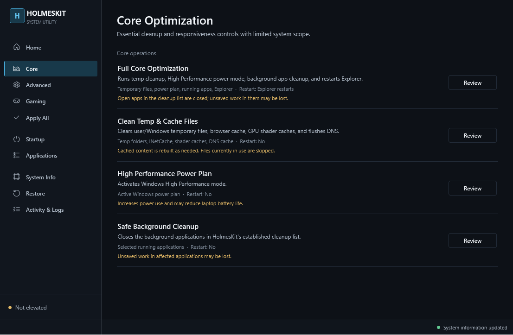

# HolmesKit

HolmesKit is a Windows system-management and optimization toolkit with two interfaces:

- **Desktop:** `HolmesKit.exe`, a native C#/WPF utility.
- **CLI:** `HolmesKit.bat`, the independent Batch/PowerShell menu.

Both use the same existing operations. The CLI does not require the desktop or .NET.

> **Validation candidates only.** No public release is published by this workflow. Native Windows recovery, accessibility/DPI and licensing gates remain outstanding. Candidates are unsigned. Save work and review scope: performance improvements are not guaranteed, and recovery is limited.

## Capabilities

Home; Core Optimization; Advanced Tweaks; Gaming Mode; Apply All; Startup Manager; Applications Manager; System Information; Restore; Activity & Logs.

Operations include cache cleanup, power selection, managed registry/service changes, startup management and network maintenance. Startup Manager toggles entries without deleting them; Applications launches registered uninstallers. Review shows tradeoffs and restart guidance. Apply All confirms once and stops on checked failures, but earlier changes may remain.



## Requirements and running

- Windows 10/11 x64 are targets, not a completed compatibility matrix.
- Windows PowerShell 5.1 and administrator approval for system operations.
- .NET 10 SDK for source builds; self-contained candidates include the runtime.

For CLI use, run `HolmesKit.bat` as administrator. For desktop use, launch `HolmesKit.exe` and keep its adjacent `HolmesKit.bat` and complete `modules/` folder together. Declining UAC cancels startup. Per-user changes apply to the elevated account; alternate administrator credentials may target a different HKCU.

Independently initiated changes require fresh affirmative confirmation (CLI: exactly Y/y). Blank, declined, invalid or unavailable input grants no approval. `--run` is an automation entry for an already-authorized caller, not a second console prompt. Internal engine coordination is not a security API.

Modifying operations disable normal Cancel/window close; read-only queries remain cancellable. Forced termination and power loss are not rollback. Do not bypass recovery blocks by deleting or editing journals.

## Build and safe tests

```powershell
dotnet restore HolmesKit.slnx
dotnet build HolmesKit.slnx -c Release --no-restore
dotnet test HolmesKit.slnx -c Release --no-build
dotnet run --project src/HolmesKit.Desktop/HolmesKit.Desktop.csproj -c Release
```

Ordinary tests use inert command stubs, mocked native adapters and temporary fixtures; they do not execute native optimizations. Keep `HOLMESKIT_VISUAL_REVIEW_DIR` unset for the normal suite. Compilation/fixtures do not establish Windows recovery correctness.

## Portable candidates

```powershell
./tools/Publish-Portable.ps1 -Version 0.3.0-rc.1
./tools/Test-PortableCandidate.ps1 -CandidateZip ./artifacts/packages/HolmesKit-0.3.0-rc.1-win-x64.zip
```

Copy the entire extracted folder. Packaging includes the EXE, Batch/modules, documentation, version and checksums; it excludes local recovery/logs. CI runs safe Windows tests. The manual candidate workflow creates an Actions artifact, not a public Release or tag. The verifier checks content/integrity, not publisher authenticity or native behavior. No installer, updater, signing certificate or download website is supplied.

## Recovery and safety

A retained `HolmesKit_Backups/recovery/baseline.json` preserves Before states across operations. Updates are staged/atomically published; the preceding envelope is retained. Recovery validates scope, identity and corruption checks, then restores supported managed registry values, service states and power selection while skipping external conflicts. Checksums are not authentication against malicious rewriting.

Legacy exports remain preserved and require manual review. Interrupted/corrupt/mismatched journals and changed adapter scope fail closed. Network/TCP globals, NTFS and hibernation are partial or reset-only. Deleted files, uninstalled apps and unsaved work cannot be restored. Force-closing apps and network resets can be disruptive.

Use an ordinary extracted folder; protected installation directories are not supported. Preserve the old folder/recovery data during upgrades. Deleting HolmesKit does not reverse Windows changes. Keep raw journals/logs private and redact diagnostic details before sharing.

## Help and development

- [User, developer, recovery and release handbook](docs/HANDBOOK.md)
- [Source-derived feature inventory](docs/feature-parity.md)
- [Disposable-VM matrix and read-only evidence collection](docs/WINDOWS_VM_VERIFICATION.md)
- [Release-gate checklist](docs/RELEASE_READINESS.md)

`HolmesKit.bat` supplies menus/allowlisted operation labels; `modules/recovery.ps1` coordinates recovery and `recovery_core.ps1` isolates policy/native access; `gui_bridge.ps1` returns structured system/management data. WPF uses an asynchronous process service. See the handbook before modifying an operation's managed scope or recovery schema.

No project licence has been selected. A public repository alone does not grant open-source reuse/distribution permissions. Owner approval, native VM evidence and the release gates are required before public distribution.
